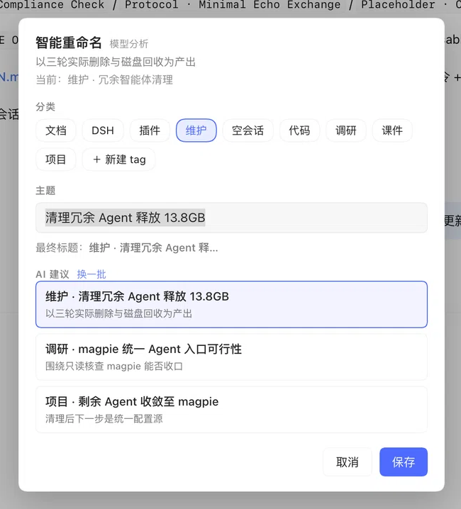

# dsh-session-smart-rename

**Name DeepSeek Harness sessions as `category · topic` — from the sidebar workbench, or from the agent itself.**

English · [简体中文](README.zh-CN.md)

[](https://www.npmjs.com/package/dsh-session-smart-rename)
[](LICENSE)
[](https://github.com/SonettoGu14/dsh-session-smart-rename#compatibility)

Most session renamers ask a model for a title and hand it back. That works until the title is wrong in a way you cannot fix — no category, the wrong angle, or a phrase you would never file under.

This plugin separates the two jobs. The model **proposes**; you **decide**. A dialog opens with your category chips, a topic field, and a live preview of the finished title, with three model suggestions underneath as click-to-fill rows. The same analyzer is also exposed to agents as a tool, so a session can rename itself when the work changes direction.

## What it looks like



Category chips on top, the topic field and a live `category · topic` preview in the middle, three click-to-fill suggestions at the bottom — **Another batch** asks again without repeating.

## Features

- **Naming workbench** — category chips (plus custom tags saved in your browser), a topic field, and a live `category · topic` preview. Enter saves, Esc closes.
- **Three angled suggestions** — each row shows the proposed title and a one-line reason; click a row to fill both fields, or ask for **another batch** without repeats.
- **Agent tool** — `smart_rename_session` lets the model pin a title, or let the plugin name the session from the conversation.
- **Pinned titles** — both entries write a `source: user` title, so automatic naming never overwrites your decision.
- **Bilingual UI** — Chinese and English are picked from the browser language; generated titles follow the language of the conversation.
- **No dependencies, no build step** — the host half uses only Node built-ins, the browser half only React from the harness.

## Install

```sh
dsh plugin --profile <your-profile> add dsh-session-smart-rename
```

Also installable from the plugin manager in **DSH Settings**, or straight from GitHub:

```sh
dsh plugin --profile <your-profile> add github:SonettoGu14/dsh-session-smart-rename
```

Restart DSH once after installing — the client bundle is loaded at boot.

## Use it from the sidebar

Sidebar session row → `…` → **Smart rename**.

| Area | What it does |
| --- | --- |
| Category chips | One click to classify; click again to clear. **＋ New tag** adds a chip and remembers it in this browser. |
| Topic field | The subject of the session — "what was this session really about?" |
| Preview | Shows the exact title that will be pinned: `category · topic`. |
| AI suggestions | Three titles with reasons. Click one to fill the two fields above. **Another batch** asks for three different ones, telling the model which titles it already offered. |

`Enter` saves, `Esc` closes. The menu entry itself never opens a dialog until the analysis finishes, so you always see suggestions before committing.

Titles are fitted to a 26-cell width budget (a CJK character counts as two), so a long English topic is cut on a word boundary instead of spilling out of the sidebar.

## Use it from the agent

`smart_rename_session`

| Parameter | Required | Description |
| --- | --- | --- |
| `title` | no | Exact title to pin. Omit it and the plugin reads the conversation and names the session itself. |
| `session_id` | no | Target session. Defaults to the session the tool is running in (which must be loaded). |

Returns `{ session_id, title, seq, source }`, where `source` is `model` (the caller supplied a title) or `analyzed` (the plugin named the session).

```js
smart_rename_session({})                              // let the plugin name the session
smart_rename_session({ title: 'PRD-042 · 推荐信导出' })  // pin an exact title, no model call
```

To let an agent keep the title current on its own, add a line like this to your `AGENTS.md`:

```md
- When the work clearly moves to a new subject and the current title no longer fits,
  call `smart_rename_session` without `title` so the plugin renames the session.
```

Not happy with the result? Rename it again from the sidebar — both paths write a `source: user` title, and the later write wins.

## How it works

- The browser half registers two seats: `sidebar.workspaces.session.menu.item` (the menu row) and `shell.overlay` (the workbench).
- The host half has one analyzer shared by both entries: read the session's user messages and assistant replies, take the model route from the session's own `request/header` event, and ask for strict JSON `{"candidates":[{category, title, reason} × 3]}`. The tool path uses the first candidate.
- `POST /api/dsh-session-smart-rename/suggest` serves the dialog; the agent uses the tool.
- Sessions the host has not loaded are read from disk (`~/.dsh/sessions/**/<id>/session.v4.jsonl.zstd`), decompressed with `zstd -dc` because the log is several concatenated frames.
- Both entries write through the host's `sessionTitle.rename` (the dialog via `POST /api/session/rename`), so the title is pinned exactly like the built-in rename.
- Titles are generated with the lowest reasoning effort the model offers, on a 2048-token budget for three candidates plus thinking, with a one-shot retry at 700 tokens if the gateway rejects the larger budget. If the model comes back with fewer than three candidates, one more call tops them up, carrying the ones you already have as "do not repeat".
- Suggestions are cached per session for five minutes; **Another batch** skips the cache. If the model or the log is unavailable, the dialog falls back to local keyword rules and labels the source `Local rules`.
- Titles are clamped to 26 display cells (a CJK character counts two), so a long topic ends with `…` in the preview — that is what the sidebar can actually show. Suggestion rows keep the model's full wording, so you still see the idea before it gets shortened.
- The parser tolerates the small JSON sins models commit — fenced blocks, prose around the object, and a stray trailing comma — instead of dropping to local rules.

## Compatibility

| Requirement | Value |
| --- | --- |
| DSH | `>=0.2.2-0 <0.3.0-0` (declared in `engines.dsh`, tested on 0.2.2-rc.3) |
| Node | `>=22.19.0` |
| Profile | Any profile that ships the session sidebar and `dsh.bundle` manifest support |

DSH enforces `engines.dsh` at install time, so a version outside the range is refused with a clear message instead of failing at runtime.

## Configuration

All optional; the defaults work without touching a config file.

```yaml
- id: session-smart-rename
  name: dsh-session-smart-rename
  config:
    provider: deepseek-official   # fallback route when the session has no request/header yet
    model: deepseek-flash
    categories: ["Docs", "DSH", "Infra"]   # what the tool path offers the model
```

## Localization

- Dialog text follows the browser language: `zh` for Chinese, English otherwise.
- Default category chips come in both languages (`Docs` / `文档`, …), and custom tags are stored per browser.
- Generated titles follow the language of the conversation, not the UI language.

## Compared with other session-rename plugins

| Plugin | Tool name | Shape |
| --- | --- | --- |
| **dsh-session-smart-rename** (this) | `smart_rename_session` | Workbench (chips + topic + three suggestions) **and** agent tool, titles pinned as `category · topic` |
| `9Ashwin/dsh-session-rename` | `rename_session` | Model-side rename only |
| `dsh-ai-session-rename` | `session_rename_ai` | Right-click rename, one model-generated title |
| `dsh-auto-rename` | — | Auto-rename on every message with three streaming candidates |
| `dsh-session-rename` (qinu321) | `session_rename` | Minimal tool, title required |

Tool names do not collide, so this plugin can be installed alongside the others.

## Known limits

- `session_id` must point at a loaded session; the current session always works.
- Each sidebar analysis is one small model call (~1–3 s); a tool call that lets the plugin name the session costs one too (passing `title` costs none).
- Custom tags live in the browser's localStorage and are invisible to the tool path, which uses the configured `categories`.
- Subagent child sessions (`origin: subagent`) are refused by the host.
- Compressed or message-less logs fall back to local rules with a single candidate.

## License

[MIT](LICENSE)
