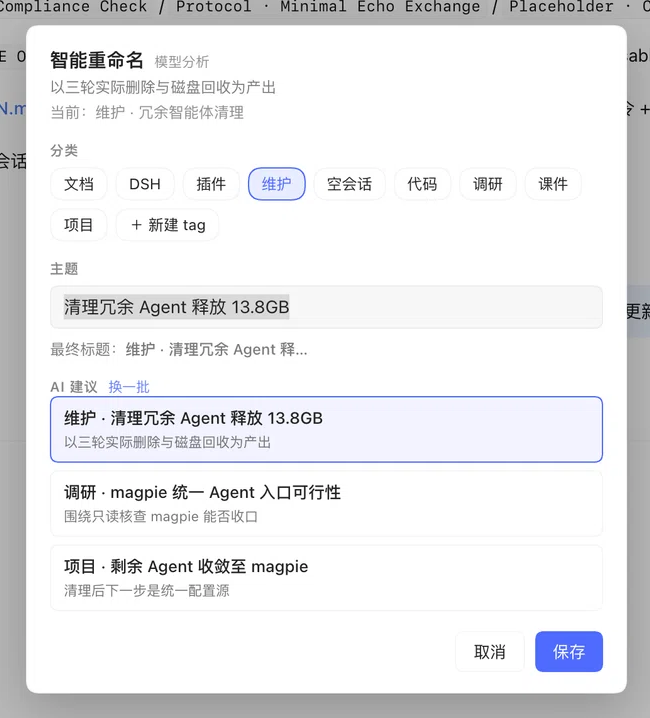
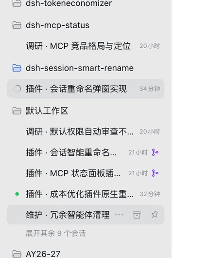

# dsh-session-smart-rename

**把 DeepSeek Harness 的会话命名成 `分类 · 主题` —— 侧边栏工作台改，或者让 agent 自己改。**

[English](README.md) · 简体中文

[](https://www.npmjs.com/package/dsh-session-smart-rename)
[](LICENSE)
[](https://github.com/SonettoGu14/dsh-session-smart-rename#%E5%85%BC%E5%AE%B9%E6%80%A7)

大部分会话重命名插件都是「让模型起个标题，直接写回去」。问题是标题一旦不对，你没法只改一部分：分类缺了、角度不对，或者那个措辞你根本不会用它归档。

这个插件把两件事拆开：模型**提建议**，人来**决定**。弹窗里是你的分类 chips、主题输入框和最终标题的实时预览，下面三条模型建议点一下就能整条填入。同一段分析逻辑也以工具的形式交给 agent——话题真正转向时，会话可以自己改名。

## 长什么样



上面是分类 chips，中间是主题输入框和 `分类 · 主题` 实时预览，下面三条建议点一下整条填入；**换一批** 会带着已给过的标题再问。



它写出来的标题都是同一个形状，侧栏就按分类自动排好了。

## 特性

- **命名工作台**：分类 chips（可新建自定义 tag，存在浏览器里）+ 主题输入框 + `分类 · 主题` 实时预览；回车保存，Esc 关闭。
- **三条不同角度的建议**：每条带一句理由，点行即填入两个字段；「换一批」会带上已给过的标题，让模型别重复。
- **模型工具**：`smart_rename_session` 可以钉住指定标题，也可以让插件读对话自动命名。
- **标题被钉住**：两个入口都写 `source: user` 的标题，自动命名不会覆盖你的决定。
- **中英双语界面**：按浏览器语言选择中文或英文；生成的标题跟随对话本身的语言。
- **零依赖、无构建步骤**：宿主半体只用 Node 内置模块，浏览器半体只用 harness 提供的 React。

## 安装

```sh
dsh plugin --profile <你的 profile> add dsh-session-smart-rename
```

也可以在 **DSH 设置 → 插件管理** 里安装，或直接从仓库装：

```sh
dsh plugin --profile <你的 profile> add github:SonettoGu14/dsh-session-smart-rename
```

安装后重启一次 DSH —— 客户端 bundle 在启动时加载。

## 人侧：侧边栏

侧边栏会话行 →「…」→ **智能重命名**。

| 区域 | 作用 |
| --- | --- |
| 分类 chips | 点一下归类，再点一下取消；**＋ 新建 tag** 添一个并记在这个浏览器里。 |
| 主题输入框 | 这次会话到底在做什么。 |
| 预览 | 显示将要被钉住的完整标题：`分类 · 主题`。 |
| AI 建议 | 三条标题 + 理由，点一条即填入上面两个字段；**换一批** 会告诉模型已给过哪些题，避免重复。 |

`回车` 保存，`Esc` 关闭。点菜单后会先等分析完成再弹窗，所以你总是先看到建议再决定。

标题按 26 格显示宽度收口（一个汉字算两格），最终标题预览里长主题会以 `…` 结尾——那就是侧栏真能显示的长度；建议行保留模型原话，先看全再收窄。英文主题断在词边界上，中文按字截断。

## 模型侧：工具

`smart_rename_session`

| 参数 | 必填 | 说明 |
| --- | --- | --- |
| `title` | 否 | 要钉住的标题。省略时插件自己读对话、按内容命名。 |
| `session_id` | 否 | 目标会话；省略即当前会话（必须已加载）。 |

返回 `{ session_id, title, seq, source }`，`source` 为 `model`（调用方给了标题）或 `analyzed`（插件分析出来的）。

```js
smart_rename_session({})                              // 让插件自己命名
smart_rename_session({ title: 'PRD-042 · 推荐信导出' })  // 钉住指定标题，不再调模型
```

想让 agent 在任务换挡时自己更新标题，把这段加进你的 `AGENTS.md`：

```md
- 当一次会话的工作明显转到新主题、旧标题已经不准确时，调用 `smart_rename_session`（不传 title），
  让插件按对话内容重新命名。
```

不满意？直接回侧边栏再改一次——两条路都写 `source: user` 的标题，后写的覆盖先写的。

## 实现

- 浏览器半体注册两个座位：`sidebar.workspaces.session.menu.item`（菜单行）与 `shell.overlay`（工作台弹窗）。
- 宿主半体只有一段分析逻辑，两条入口共用：读会话的用户消息与助手回复，从会话自己的 `request/header` 事件取模型路由，要求严格 JSON `{"candidates":[{category, title, reason} × 3]}`；工具路径取第一条候选。
- `POST /api/dsh-session-smart-rename/suggest` 服务弹窗，工具服务 agent。
- 宿主没加载过的会话直接读磁盘日志（`~/.dsh/sessions/**/<id>/session.v4.jsonl.zstd`），用 `zstd -dc` 解压——日志是多个 zstd 帧拼接的。
- 两个入口都通过宿主的 `sessionTitle.rename` 写标题（弹窗走 `POST /api/session/rename`），跟内置重命名的钉住语义一致。
- 生成标题时用模型声明的最低推理档，2048 token 预算覆盖三条候选加思考；网关拒绝大预算时退到 700 token 重试一次。模型只回不到三条候选时，会带着「已有的别再给」再补问一次。
- 建议按会话缓存五分钟，「换一批」跳过缓存；模型或日志不可用时退回本地关键词规则，并把来源标成「本地规则」。

## 兼容性

| 要求 | 值 |
| --- | --- |
| DSH | `>=0.2.2-0 <0.3.0-0`（写在 `engines.dsh`，实测 0.2.2-rc.3） |
| Node | `>=22.19.0` |
| Profile | 任意带会话侧边栏、支持 `dsh.bundle` 清单的 profile |

DSH 在安装时就会校验 `engines.dsh`，版本不对会直接拒绝并说明原因，而不是留到运行时才出问题。

## 配置

全部可选，默认值开箱可用。

```yaml
- id: session-smart-rename
  name: dsh-session-smart-rename
  config:
    provider: deepseek-official   # 会话还没有 request/header 时的兜底路由
    model: deepseek-flash
    categories: ["文档", "DSH", "基建"]   # 工具路径交给模型的候选分类
```

## 本地化

- 弹窗文案跟随浏览器语言：`zh` 开头用中文，其余用英文。
- 出厂分类 chips 有中英两套（`文档` / `Docs` …），自定义 tag 存在各自浏览器里。
- 生成的标题跟随对话本身的语言，而不是界面语言。

## 和其他会话改名插件的区别

| 插件 | 工具名 | 形态 |
| --- | --- | --- |
| **dsh-session-smart-rename**（本插件） | `smart_rename_session` | 命名工作台（chips + 主题 + 三条建议）**加** 模型工具，标题钉成 `分类 · 主题` |
| `9Ashwin/dsh-session-rename` | `rename_session` | 只有模型侧改名 |
| `dsh-ai-session-rename` | `session_rename_ai` | 右键改名，一条模型标题 |
| `dsh-auto-rename` | — | 每条消息自动改名，三条流式候选 |
| `dsh-session-rename`（qinu321） | `session_rename` | 极简工具，必须给 title |

工具名互不冲突，可以和上面任意一个同时安装。

## 已知限制

- `session_id` 必须指向已加载的会话；当前会话永远可用。
- 每次点侧边栏 = 一次小模型调用（约 1~3 秒）；让插件自动命名的工具调用也要一次（显式给 `title` 不调）。
- 自定义 tag 存在浏览器 localStorage，工具路径看不到，它用配置里的 `categories`。
- 子代理会话（`origin: subagent`）会被宿主拒绝改名。
- 压缩过或没有用户消息的日志会退回本地规则，只有一条候选。

## 许可证

[MIT](LICENSE)
